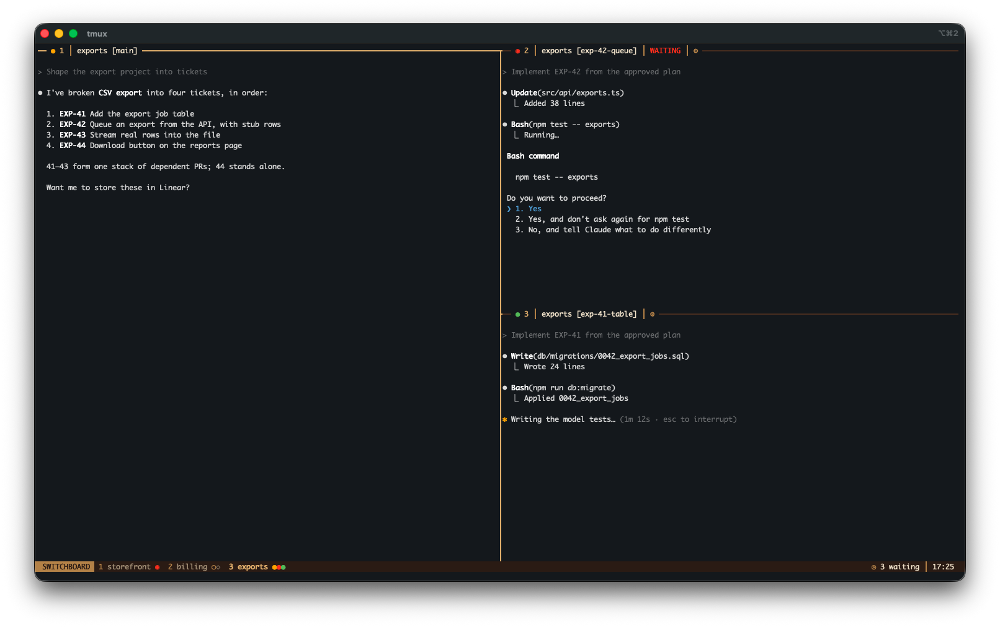
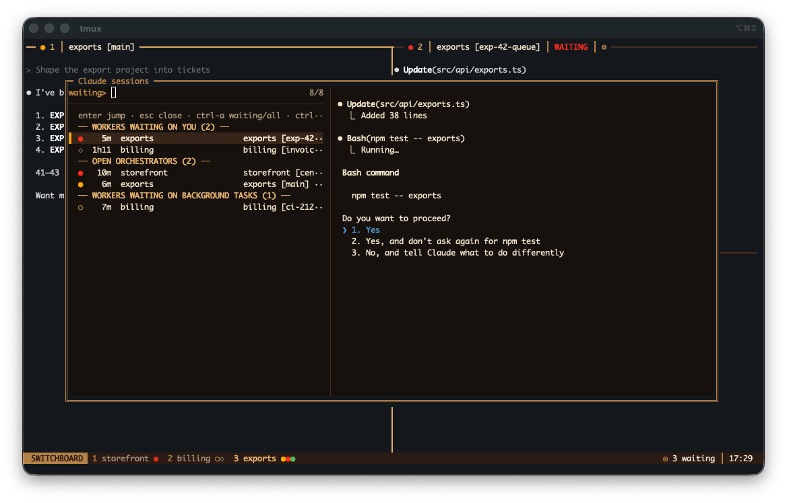

# switchboard

A Claude Code plugin to manage parallel work in tmux – blinking lights included.

See at a glance which sessions are waiting on you, get notified when one is and jump
straight to it.



- **Lamps** in the status bar and on pane borders show which sessions are working,
  blocked or done.
- **`prefix + j`** opens a picker of every session, waiting ones first. Enter jumps to it.

  

- **`/sb:shape-tickets`** breaks a project into a sequenced chain of tickets.
- **`/sb:plan-ticket`** plans one ticket from that chain, for your approval.
- **`/sb:dispatch`** hands an approved plan to a worker Claude in its own worktree and
  pane, which opens a draft PR and fixes its failing checks.

## Install

```
/plugin marketplace add grumbling-tom/switchboard
/plugin install switchboard@switchboard
```

macOS only. Needs tmux, jq, fzf and alerter:
`brew install tmux jq fzf vjeantet/tap/alerter`. switchboard warns at session start if
any are missing.

See [docs/reference.md](docs/reference.md) for every command, key binding, setting and
lamp colour.
